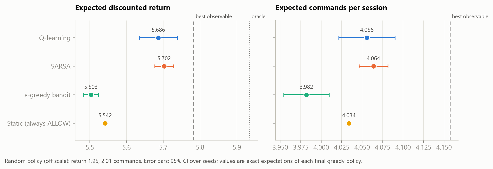
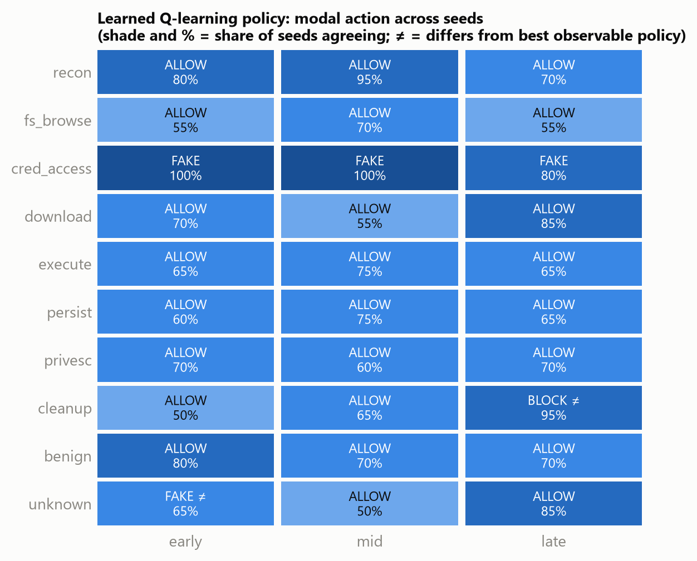
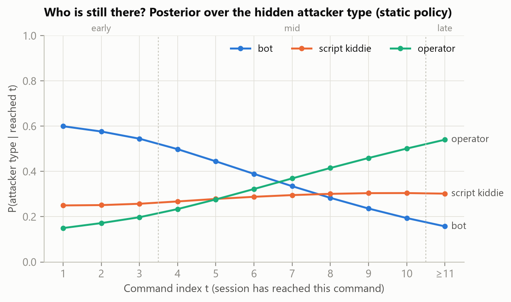
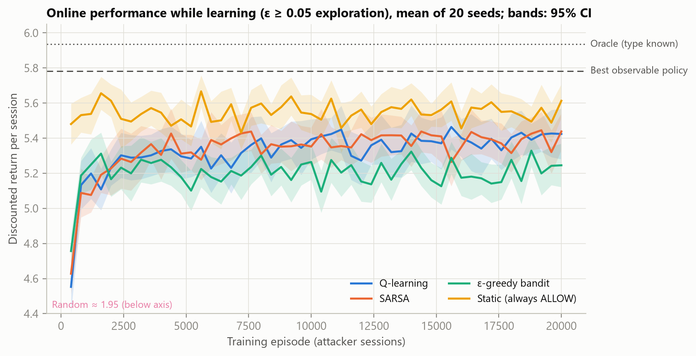
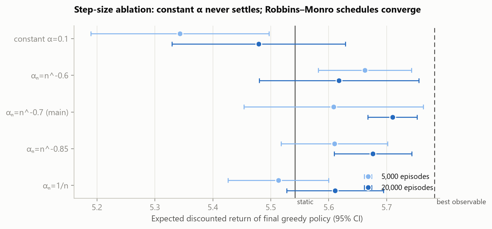
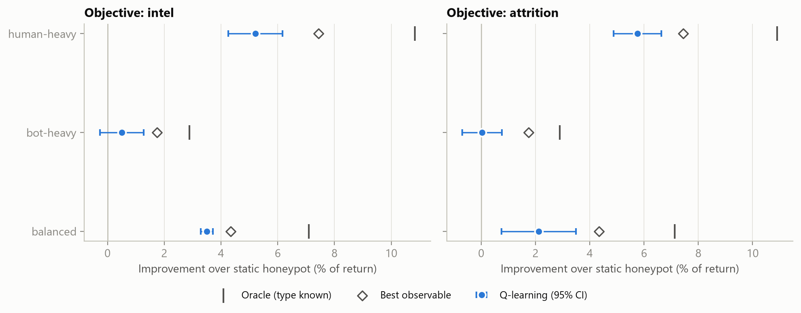

# CruxTrap — Evaluation of the Adaptive Response Policy

This chapter answers the research questions from `01-problem-statement.md`:

- **RQ1.** Does a learned response policy capture more attacker behaviour than a static honeypot?
- **RQ2.** How does the answer depend on the attacker population and the defender's objective?

All numbers are reproduced by `python -m simulator.experiments` (≈1 minute on 8 cores,
fixed seeds). Raw results: [`results/results.json`](results/results.json); tables:
[`results/summary.md`](results/summary.md); figures: `figures/`.

---

## 1. Method

### 1.1 Attacker model

A real Internet-facing deployment cannot be used to *compare* policies: each policy would
face different attackers on different days, and learning curves need tens of thousands of
sessions. We therefore evaluate against a **generative attacker model** (`simulator/model.py`)
and keep it honest in two ways: the agent code, reward function and state encoding are the
*same objects* used by the live honeypot, and the model's parameters can be re-estimated
from captured sessions (§1.5).

The population is a mixture of three attacker types, each a first-order Markov chain over
the 10 command categories with a per-category exit probability:

| Type | Share (balanced) | Behaviour | Reaction to honeypot actions |
|---|---|---|---|
| bot | 60% | short scripted recon → download → execute | indifferent to content; DELAY ×0.90 and TARPIT ×0.35 on continue-probability (time-outs) |
| script kiddie | 25% | browses, looks for credentials, impatient | DELAY ×0.80, TARPIT ×0.30; FAKE on `cred_access` ×1.15 and steers the next command toward credentials/download |
| operator | 15% | patient, methodical, credential-focused | TARPIT ×0.60; FAKE on `cred_access` ×1.20 (chases the honeytoken), but FAKE on `recon`/`fs_browse` ×0.85 (fabricated system data is inconsistent) |

BLOCK sets continuation to 0; no action can push continuation above 0.98. The honeypot
never observes the type: from its point of view the environment is a **partially
observable** mixture. These parameters are modelling assumptions informed by the
qualitative literature on SSH attackers (mostly short bot sessions; rarer, longer human
sessions that target credentials), not measurements — §3 tests how much the conclusions
depend on them.

### 1.2 Exact evaluation

Because the model is known, the expected performance of any policy can be computed
**exactly** instead of estimated. Augment the state with the hidden type *k* and the command
index *t* (capped at 11, after which the phase is always *late*):
x = (k, c, t), |X| = 3 × 10 × 11 = 330. A policy π over the honeypot's observation
(c, phase(t)) induces a sub-stochastic transition matrix P_π and expected reward r_π on X, so

  V_π = (I − γ P_π)⁻¹ r_π  (discounted return)
  N_π = (I − P_π)⁻¹    (fundamental matrix: expected visits)

Expected commands per session are μ₀ᵀ N_π 𝟙, expected intel μ₀ᵀ N_π v, and so on, where μ₀
is the start distribution. Every reported "return" or "commands" figure is this exact value
for the policy a run ended with. The variance across seeds is therefore purely the
variance of *learning*, not of evaluation.

**Validation.** For the seed-0 learned policy, 50,000 Monte-Carlo episodes give return
5.442 ± 0.043 and 3.884 ± 0.027 commands against exact values 5.464 and 3.899; the unit
tests check the same agreement (within 4 standard errors) for the static, random and a
trained policy. The linear-algebra model and the simulator describe the same process.

### 1.3 Benchmarks

| Benchmark | How it is obtained | Meaning |
|---|---|---|
| **Oracle** | value iteration on the full 330-state MDP | best possible if the honeypot *knew* the attacker type: an upper bound |
| **Best observable** | exact policy evaluation inside coordinate ascent with 8 restarts over the 5³⁰ deterministic policies on (c, phase) | the best the honeypot's own state representation allows; the realistic ceiling for learning |
| **Static** | always ALLOW | a conventional honeypot (Cowrie-equivalent behaviour) |
| **Random** | uniform over the 5 actions | sanity floor |

Finding the optimal memoryless policy of a POMDP is NP-hard in general, so "best observable"
is a strong local optimum, not a proven optimum. It is, however, always ≥ static and ≤ oracle,
and all restarts converge to the same policy.

### 1.4 Learners and protocol

Q-learning, SARSA (same 30 states) and a state-blind ε-greedy bandit, all with γ = 0.9,
ε₀ = 0.3 decaying ×0.995 per episode to 0.05, and step size αₙ(s,a) = n(s,a)^−0.7.
**20 seeds × 20,000 episodes** each; the final greedy policy of every run is evaluated
exactly. Confidence intervals are 95% Student-t over seeds. Hypothesis tests: one-sample
t-test of Q-learning's final return against the (deterministic) static value; Welch's
t-test between Q-learning and SARSA.

The step-size schedule was chosen after a pilot run on *disjoint* seeds (§2.4) and fixed
before the reported runs. Seeds: 0–19 main, 1000+ sensitivity, 2000+ ablation, 50,000+
and 70,000+ pilot/diagnostics.

### 1.5 Fitting the model to data

`simulator/fit.py` gives the maximum-likelihood estimate of a chain from category sequences
(π̂(c) = starts/sessions, P̂(c,c′) = transitions/out-transitions, ê(c) = exits/visits, with
optional Laplace smoothing). A unit test recovers a known chain from 20,000 simulated
sessions to within 0.02 in every well-visited entry. Applied to sessions captured under the
static policy, it replaces the assumed parameters with measured ones.

---

## 2. Results

### 2.1 RQ1: does learning beat a static honeypot?

| Policy | Return | Commands / session | Intel / session |
|---|---|---|---|
| Q-learning | **5.686 ± 0.051** | 4.056 ± 0.034 | 9.91 ± 0.10 |
| SARSA | **5.702 ± 0.026** | 4.064 ± 0.018 | 9.93 ± 0.05 |
| ε-greedy bandit | 5.503 ± 0.021 | 3.982 ± 0.028 | 9.58 ± 0.03 |
| Static | 5.542 | 4.034 | 9.64 |
| Random | 1.949 | 2.015 | 3.91 |
| Best observable | 5.783 | 4.157 | 10.22 |
| Oracle | 5.935 | — | — |

- **Yes, significantly.** Q-learning exceeds static by 2.6% in return (t = 5.88, p = 5.8 × 10⁻⁶,
  n = 20) and captures **60% ± 21%** of the improvement available to the best observable policy.
  The effect on commands per session is small (+0.5%) but the effect on *what* is captured is
  larger: intel per session +2.8%, because the gain comes from credential-hunting sessions.
- **Q-learning and SARSA are indistinguishable** (Welch p = 0.57).
- **State matters.** The bandit, which learns one action for all situations, is *worse* than
  static: no single action beats ALLOW everywhere, and the useful deviation (below) is
  state-specific.
- **What is learned.** The best observable policy deviates from ALLOW in exactly one place:
  **FAKE on `cred_access` in every phase**. Q-learning finds this in 100% of seeds for
  early/mid and 80% for late (figure below). The oracle's further +2.6% requires knowing the
  type, which the honeypot cannot observe.

Agreement with the best policy is 68% of states, yet the return is 60% of the way to it:
most disagreements are in states where the actions are nearly equivalent (bots barely react)
or rarely visited, so they cost almost nothing.

### 2.2 Why the phase is in the state

Under the static policy the posterior over the hidden type shifts sharply with the command
index: bots are 60% of sessions at t = 1 but 16% of sessions that reach t ≥ 11, while
operators rise from 15% to 54%. Phase is therefore a cheap **sufficient-ish statistic for
the attacker type**, which is why a (category, phase) state outperforms category alone.

### 2.3 Learning dynamics and the cost of exploration

The online curves include ε ≥ 0.05 exploration, i.e. roughly one random action in twenty,
some of them session-ending BLOCKs. While learning, all three learners stay **below** the
static honeypot (≈5.42 vs ≈5.55 at the end). The greedy policy they have learned is better
than static, but the exploration needed to keep learning costs more than the adaptation
gains. **Deployment recommendation:** after an initial learning period, decay ε towards 0
(a GLIE schedule) or serve the greedy policy while learning off-policy from logged sessions.

### 2.4 Step size: a negative result that theory explains

| Step size | 5,000 episodes | 20,000 episodes |
|---|---|---|
| constant α = 0.1 | 5.343 ± 0.154 (2/10 beat static) | 5.479 ± 0.150 (4/10) |
| αₙ = n^−0.6 | 5.662 ± 0.080 (9/10) | 5.618 ± 0.138 (7/10) |
| **αₙ = n^−0.7** | 5.608 ± 0.155 (8/10) | **5.710 ± 0.043 (10/10)** |
| αₙ = n^−0.85 | 5.610 ± 0.092 (7/10) | 5.676 ± 0.067 (8/10) |
| αₙ = 1/n | 5.513 ± 0.087 (4/10) | 5.611 ± 0.083 (6/10) |

The project's first run used the constant α = 0.1 from the original design and **lost to the
static honeypot**. The cause is the step size, not the algorithm. With constant α the
estimate never converges; its standard deviation stays at about σ√(α/(2−α)) ≈ 0.23σ, while
the true gaps between actions in the most-visited states are of the same order. The greedy
choice is then decided by noise. A per-pair schedule αₙ = n^−ω with ½ < ω ≤ 1 satisfies the
Robbins–Monro conditions (Σα = ∞, Σα² < ∞) under which Watkins & Dayan (1992) prove
convergence, and the first update (α₁ = 1) also erases the arbitrary initial value. The
1/n schedule is the worst of the convergent ones, as Even-Dar & Mansour (2003) predict for
Q-learning: early bootstrapped targets are wrong and 1/n weights them too long. Ranking
*among* ω ∈ {0.6, 0.7, 0.85} is not significant with 10 seeds; the robust conclusion is
"decaying, not constant, and not 1/n".

Trade-off: a convergent schedule stops adapting, while a real attacker population drifts.
For long deployments set a floor `RL_ALPHA_MIN` (e.g. 0.01), which bounds the noise at a
much lower level than α = 0.1 while still tracking drift.

### 2.5 A residual bias: BLOCK at late cleanup

95% of Q-learning runs choose BLOCK in `cleanup|late`, where the best observable policy
keeps ALLOW. Diagnosis on fresh seeds: the learned Q(ALLOW) there is **1.18 against a true
2.04**, while Q(BLOCK) is exact (2.00 vs 2.00). Late states are rarely visited, so the
values ALLOW bootstraps from are still near their initial level; BLOCK's target is
terminal and does not bootstrap. Once BLOCK is greedy, ALLOW receives half as many updates
(109 vs 199), so the underestimate persists. The cost is 0.0017 in return (0.03%).
Remedies (optimistic initial values, double Q-learning) are left as future work rather
than tuned on the reported seeds.

### 2.6 RQ2: sensitivity to attackers and objective

| Mix | Objective | Static | Q-learning | Best observable | Oracle |
|---|---|---|---|---|---|
| balanced | intel | 5.542 | 5.736 ± 0.012 | 5.783 | 5.935 |
| bot-heavy | intel | 5.133 | 5.159 ± 0.039 | 5.222 | 5.281 |
| human-heavy | intel | 6.273 | 6.600 ± 0.060 | 6.740 | 6.953 |
| balanced | attrition | 5.542 | 5.659 ± 0.076 | 5.783 | 5.937 |
| bot-heavy | attrition | 5.133 | 5.135 ± 0.038 | 5.222 | 5.282 |
| human-heavy | attrition | 6.273 | 6.634 ± 0.055 | 6.740 | 6.957 |

(10 seeds each. The *attrition* objective rewards attacker time consumed, w_c = −0.05.)

- **Adaptation pays in proportion to how adaptive the attackers are.** Gain over static:
  +0.5% against bot-heavy traffic (not significant), +3.5% balanced, +5.2% human-heavy.
  Against scripted bots, a static honeypot is already close to optimal.
- The learned structure is stable: FAKE on credential access in every scenario; with many
  bots, FAKE on file browsing too; under the attrition objective, DELAY on late cleanup
  (sessions about to end anyway are slowed down at no intelligence cost).
- Even when the defender values wasting attacker time, the policy never chooses TARPIT:
  under this model the sessions it would end are worth more than the seconds it would waste.

---

## 3. Threats to validity

1. **Model dependence.** Effect sizes depend on the assumed reaction multipliers. The
   qualitative conclusions (static is near-optimal against bots; FAKE on credential access
   is the one robust deviation; decaying step size is required) hold across all six
   scenarios. Fitting the chain to real sessions (§1.5) is the way to tighten this; note
   that reaction multipliers can only be estimated from sessions served under different
   actions, i.e. from the live learner's own exploration.
2. **Category-level abstraction.** The simulator generates command categories, not command
   strings, so classifier errors on real input are not modelled.
3. **Stationarity.** Real populations drift (botnet campaigns come and go). Experiments
   assume a fixed mixture.
4. **Reward design.** Return is defined by the reward in `02-mdp-formulation.md`; commands
   and intel per session are reported alongside it so conclusions do not rest on the reward
   weights alone.
5. **"Best observable" is a local optimum** of an NP-hard problem (§1.3).

## 4. Summary

On a partially observable attacker population, tabular Q-learning over (command category,
session phase) learns, without supervision, the deception that matters, **serving fake
credentials to attackers looking for credentials**. It beats a static honeypot with high
statistical confidence and reaches 60% of the achievable improvement. Getting there
required replacing the constant learning rate with a Robbins–Monro schedule, a change
predicted by stochastic-approximation theory and confirmed by ablation. The size of the
benefit is modest and depends on how many attackers are human; against purely scripted
bots a static honeypot is already near-optimal. Online exploration costs about as much as
adaptation gains, so a deployment should reduce exploration once the policy has settled.

## References

- C. J. C. H. Watkins and P. Dayan, "Q-learning," *Machine Learning* 8, 279–292, 1992.
- E. Even-Dar and Y. Mansour, "Learning rates for Q-learning," *JMLR* 5, 1–25, 2003.
- S. P. Singh, T. Jaakkola, M. I. Jordan, "Learning without state-estimation in partially
  observable Markovian decision processes," *ICML*, 1994.
- H. van Hasselt, "Double Q-learning," *NeurIPS*, 2010.
- H. Robbins and S. Monro, "A stochastic approximation method," *Ann. Math. Statist.* 22, 1951.
- R. S. Sutton and A. G. Barto, *Reinforcement Learning: An Introduction*, 2nd ed., MIT Press, 2018.
